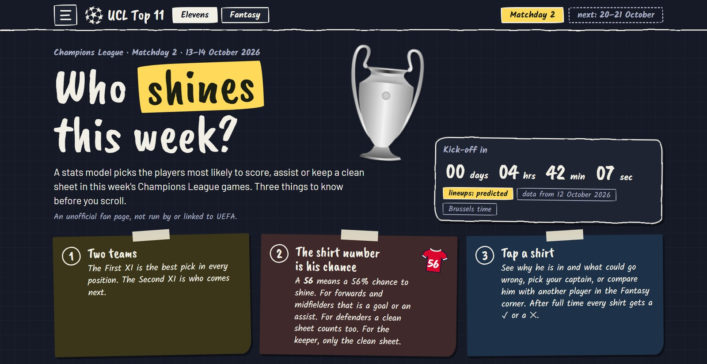
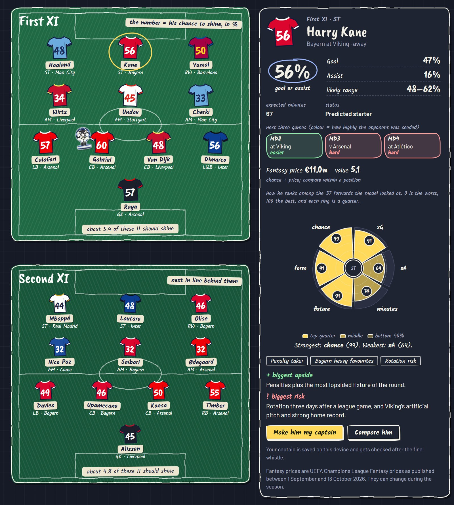
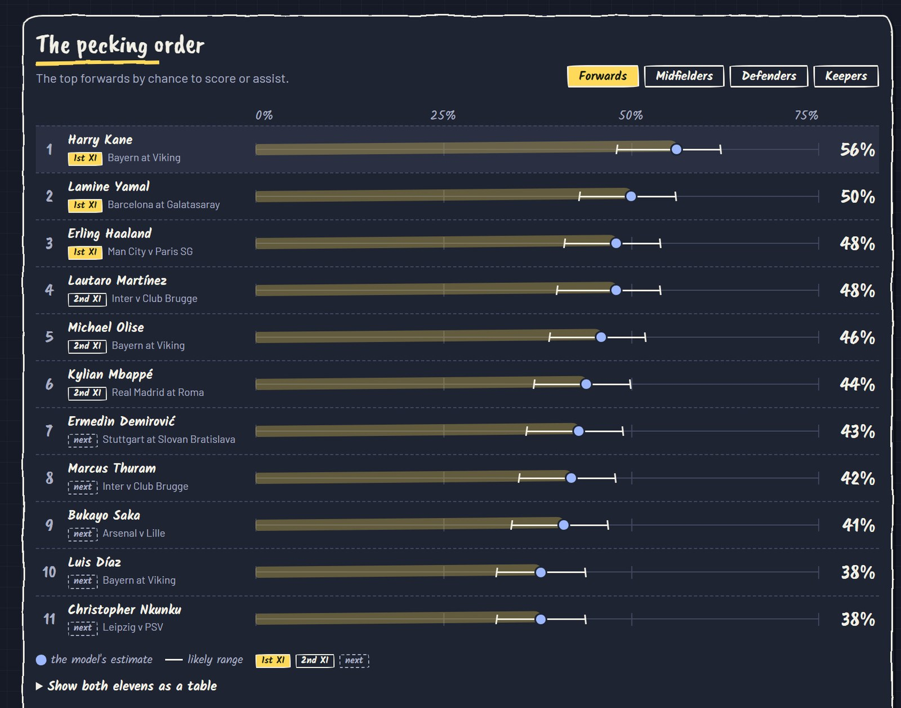
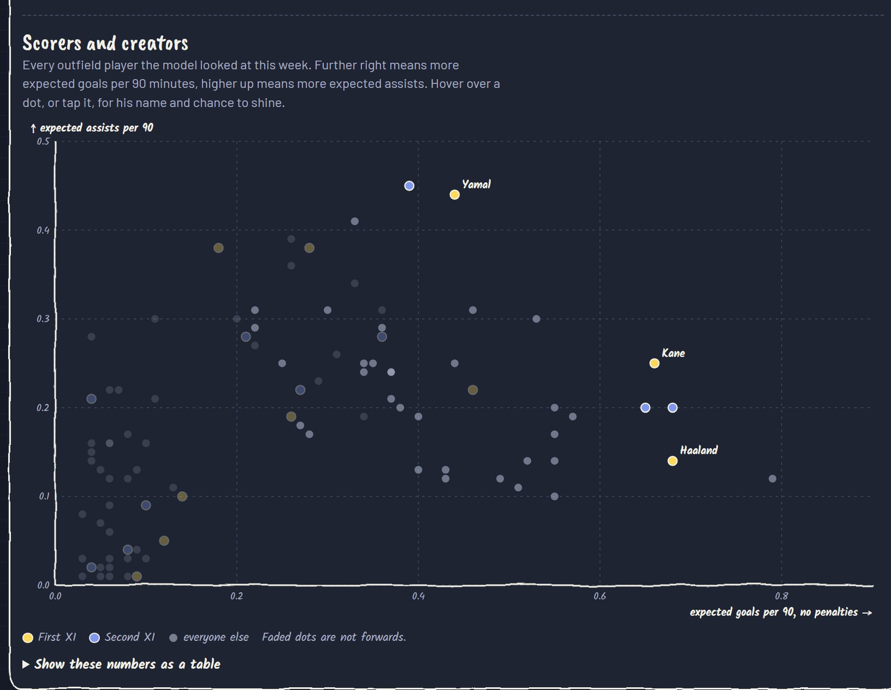
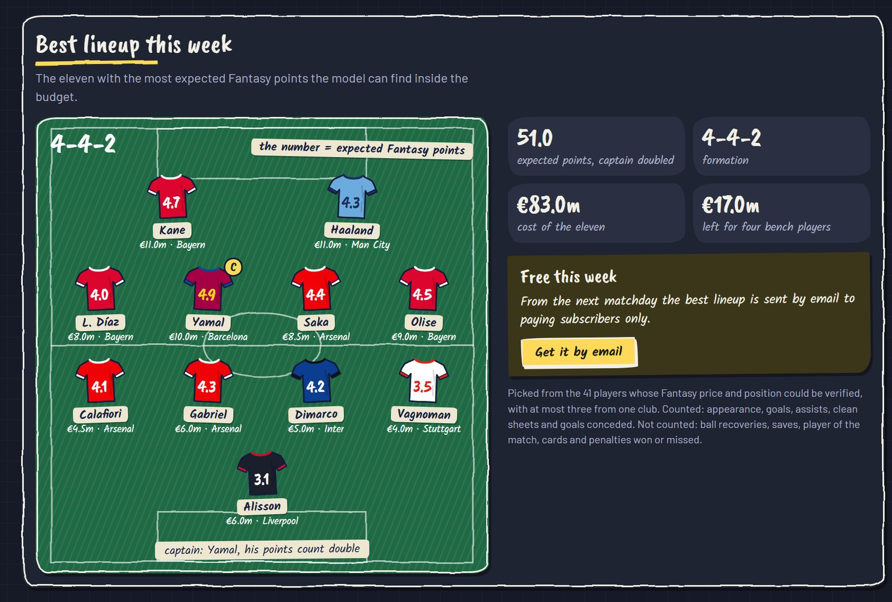
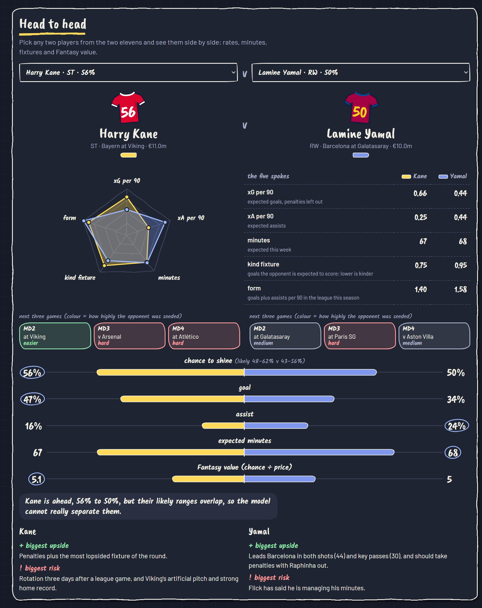
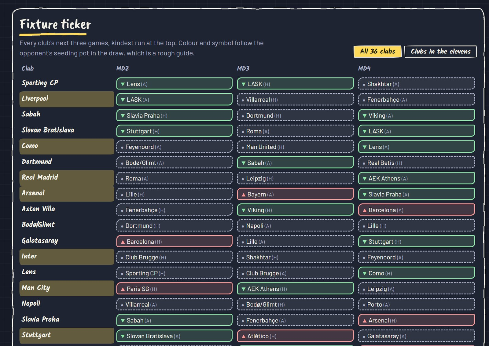
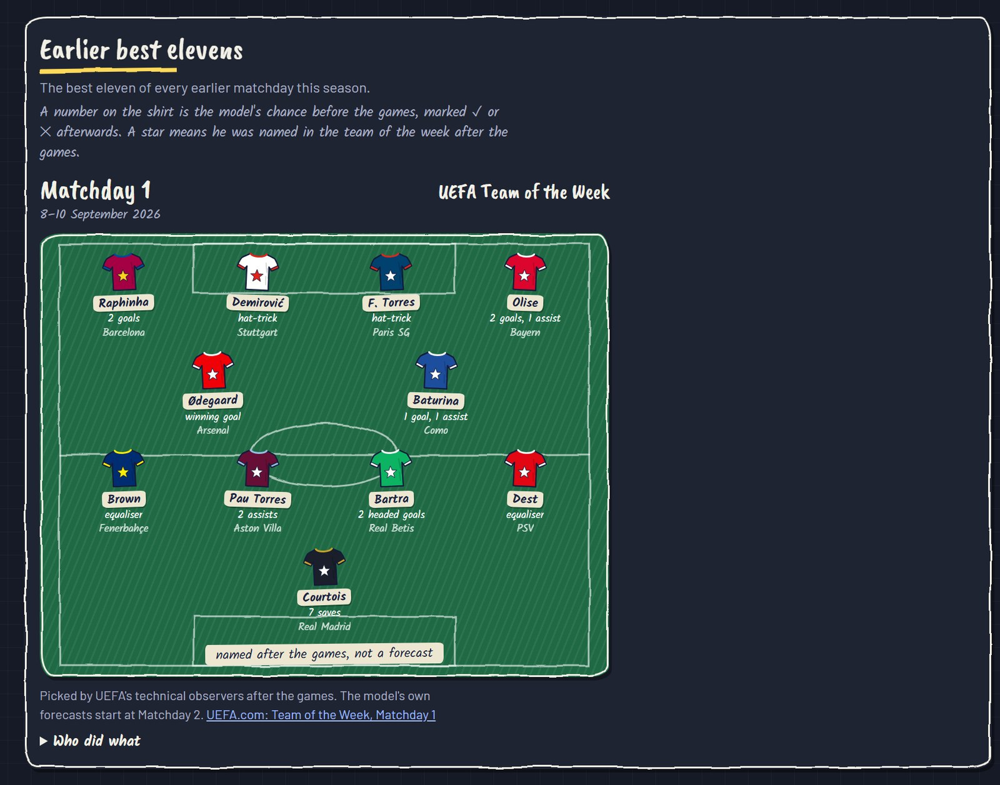
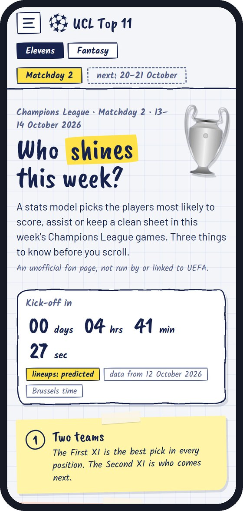

# UCL Top 11 ⚽

### Who shines this week?

Before every Champions League matchday, a stats model picks the two best elevens: the players most likely to score, assist or keep a clean sheet. Every shirt number is that player's chance, in percent.

**[▶ Open the live site](https://kevin19e.github.io/ucl-top11/)**

Screenshots are from Matchday 2 (13–14 October 2026). The live site shows the current round.

## Why it is fun

- **It looks like a coach's notebook.** Squared paper, marker headlines, taped notes and hand-drawn pitches. No dashboard grey.
- **One number per player.** A `56` on Harry Kane's shirt means a 56% chance of a goal or an assist. Nothing to decode.
- **It commits before kick-off and then marks itself.** After full time every shirt gets a ✓ or a ✕, and the track record stays on the page.
- **It says what it does not know.** Missing data is shown as "unknown", lineups are labelled "predicted", and every chance comes with a likely range.

## The tour

### 1. Two elevens on a pitch

The First XI is the best pick in every position of a 4-3-3. The Second XI is who comes next. Tap any shirt to open his card: the chance split into goal and assist, expected minutes, his next three games, his Fantasy price, and a pizza chart of how he ranks against everyone else in his line.

The small trophy marks the model's man of the match tip: the First XI player with the highest chance.

### 2. The pecking order

Every line ranked, with the likely range drawn as a whisker, so you can see when two players are too close to call. Below it, every outfield player the model looked at is plotted by expected goals against expected assists.

| Ranked by chance | Scorers and creators |
|---|---|
|  |  |

### 3. The Fantasy corner

A second page for Champions League Fantasy managers.

**Best lineup.** The eleven with the most expected Fantasy points that fits the budget, with at most three players per club. Only players whose Fantasy price and position could be verified are eligible.

**Head to head.** Pick any two players and compare them on a radar, on their next three games and on value for money. The verdict tells you plainly when the model cannot separate them.

**Fixture ticker.** The next three games of all 36 clubs in one grid, kindest run at the top.

### 4. It remembers

The bottom of the page keeps the best eleven of every earlier matchday of the season, each drawn on its own pitch.

### 5. It works on a phone, in light and dark

## What counts as shining

| Position | What counts |
|---|---|
| Goalkeeper | Keeps a clean sheet |
| Defenders | Keep a clean sheet, or score or assist |
| Midfielders and forwards | Score or assist |

The Second XI is the best eleven left once the first is picked.

## How the numbers are made

1. **Rate.** Expected goals and expected assists per 90 minutes from [Understat](https://understat.com/) league data: this season in full, last season at half weight, shrunk toward a position average (900 pseudo-minutes) so small samples are not overrated.
2. **Opponent.** The rate is scaled by the team's expected goals in this match (estimated from bookmaker prices) relative to its league average.
3. **Minutes.** Multiplied by expected minutes, from the chance the player starts (UEFA.com predicted line-ups and team news).
4. **Penalties.** A top-up for penalty takers.
5. **Probability.** `P(goal or assist) = 1 − exp(−λ)`. Clean sheet = `exp(−opponent expected goals) × P(start)`. For defenders the two are combined.
6. **Selection.** A 4-3-3: one keeper, two full-backs, two centre-backs, three midfielders, three forwards, with at most two defenders from one club.

The model for each round is in `ucl_mdN_model.py`. Run it with `python ucl_md2_model.py`.

## Under the hood

- **One HTML file.** No framework, no bundler, no analytics. The charts, shirts and pitches are hand-written SVG.
- **Python for the model.** Plain Python, no dependencies, one script per matchday so every round can be re-run.
- **Hosted on GitHub Pages.** `python build.py` turns the page source into `index.html`.

## Updates

The site is refreshed before every matchday. After each round, every pick is marked as delivered or blank and the track record on the site is updated.

The bottom of the site keeps the best eleven of every earlier matchday, drawn on a pitch.

| Round | Dates | Status |
|---|---|---|
| Matchday 1 | 8–10 September 2026 | Played before the first forecast. Shown as UEFA's Team of the Week, not a model pick. |
| Matchday 2 | 13–14 October 2026 | Forecast published 12 October 2026 |

## Files

| File | What it is |
|---|---|
| `ucl-top11.html` | Page source. Round data is in the `rounds-data` script block. |
| `index.html` | The built site served by GitHub Pages. Generated by `python build.py`; do not edit by hand. |
| `build.py` | Wraps the page source into a full HTML document. |
| `assets/` | The competition logo, the trophy and the man of the match award as PNG files, plus the favicon. The page carries small copies of them inline (the `pictures` style block at the end of `ucl-top11.html`). |
| `screenshots/` | The pictures used in this README. |
| `ucl_md2_model.py` | The Matchday 2 model: inputs, method and XI picker. |
| `ucl_md2_page_data.json` | Written by the model: per-90 rates, form and opponent xG for the radar, and every modelled player for the scatter plot. |

## Limits

- These are statistical estimates, not guarantees or betting advice. No accuracy claim is made until rounds have been scored.
- Only players from the five leagues Understat covers (England, Spain, Germany, Italy, France) are modelled.
- Rates come from domestic league data, not Champions League matches.
- Lineups are predicted until about an hour before kick-off.
- This is an unofficial fan project, not affiliated with or endorsed by UEFA. The competition logo and trophy images belong to their owners.
